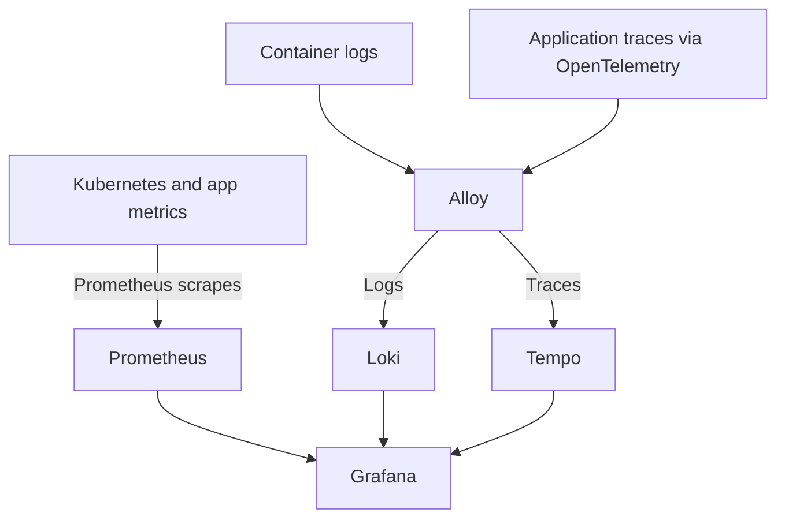

# Observability

Four components. One `observability` namespace. One Argo CD Application per component.
Parent folder only groups configuration; no parent chart, Application, or Kustomization.

| Folder / Application | Chart pin | Installs |
| --- | --- | --- |
| `kube-prometheus-stack/` | `prometheus-community/kube-prometheus-stack` `92.7.0` | Prometheus, Grafana, Alertmanager, Prometheus Operator, node-exporter, kube-state-metrics |
| `loki/` | `grafana-community/loki` `21.0.0` | Monolithic log backend; filesystem PVC |
| `tempo/` | `grafana-community/tempo` `3.2.1` | Single binary trace backend; local PVC |
| `alloy/` | `grafana/alloy` `1.15.0` | DaemonSet; Kubernetes pod logs and OTLP traces |

- Each component owns `application.yaml`, `values.yaml`, and `kustomization.yaml`.
- Import component folders into cluster overlays. Nothing installs from this folder alone.
- All Applications use project `platform-apps`; destination namespace comes from `CreateNamespace=true`.
- Prometheus runs at wave `-2`, Loki/Tempo at `-1`, Alloy at `0`.
- Automatic sync and self-healing enabled; pruning disabled. Override sync policy in cluster overlays when needed.
- Parent needs Application health checks to wait between waves. Existing children reconcile independently.
- Git values source defaults to `main`. Publish files there or patch revision before sync.
- One Grafana. Prometheus stays default data source; Loki and Tempo get stable UIDs.
- Default StorageClass required. Single-instance backends suit small clusters; no HA.
- No public ingress. Backend APIs use unauthenticated cluster traffic; restrict access for shared clusters.

Read [setup and operations](../../docs/observability.md) for AppProject permissions,
cluster selection, retention, Grafana access, and end-to-end checks.
