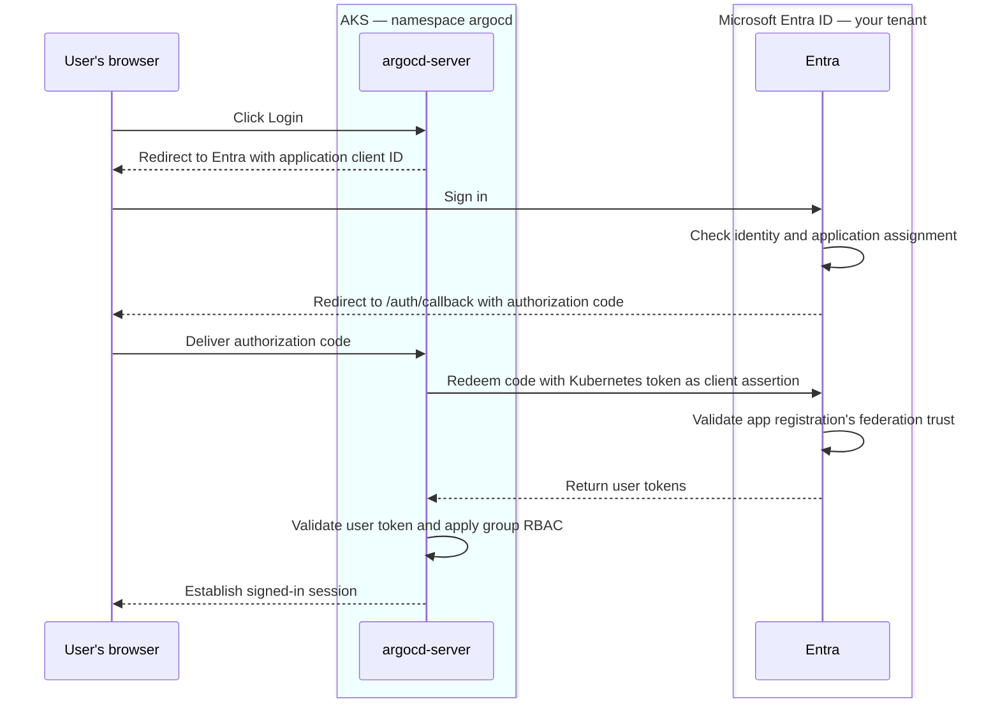

# Azure configuration templates

- [`values.yaml`](values.yaml): AGIC ingress and HTTP backend settings.
- [`sso-values.yaml`](sso-values.yaml): Entra workload identity and group RBAC in Helm values format.

Copy the required fields into cluster overrides and replace all placeholders.
Keep provider-neutral settings in [`../../values.yaml`](../../values.yaml).
For Envoy, do not copy AGIC ingress settings. Set `configs.params.server.insecure: true`
when Envoy terminates HTTPS and forwards HTTP to Argo CD.

The SSO template lets the Argo CD chart create its ServiceAccount. AKS Envoy instead
uses the account owned by `external-secrets-config`: keep `server.serviceAccount.create: false`
and its matching name. Preserve the external owner's UAMI annotations. Envoy resolves
the OIDC client ID through `$argocd-oidc:client-id`; its issuer stays in cluster values.
Review requested claims and RBAC together; the template uses groups, while the current
clusters use email. Never put secret payloads in values files.

## SSO prerequisites

- Enable the AKS OIDC issuer and workload identity.
- Set the app registration Web redirect URI to `https://argocd.example.com/auth/callback`, replacing the hostname.
- Create a federated credential on the SSO app registration. Use the AKS OIDC issuer URL, subject `system:serviceaccount:argocd:argocd-server`, and audience `api://AzureADTokenExchange`. The credential issuer is the AKS issuer, not the Entra issuer in `oidc.config`.
- Require assignment on the enterprise application and assign the allowed users or groups.
- For the template's group RBAC, configure group Object IDs in ID tokens and the required permissions and consent.
- Replace `<TENANT_ID>` with the Entra tenant GUID and `<ARGOCD_APP_CLIENT_ID>` with the SSO app registration client GUID.
- Replace `<PLATFORM_ADMIN_GROUP_OBJECT_ID>` and `<TEAM_A_GROUP_OBJECT_ID>` with the intended Entra group Object IDs.
- Create and constrain the `team-a` AppProject separately. The example grants project read access and Application read/sync access in that project. Application patterns assume Applications live in namespace `argocd`.

No separate UAMI is required for SSO. AKS Envoy's Key Vault reader uses a separate
identity and federation, as described above. Keep the workload identity label on
the server pod template through `server.podLabels`. The chart sets the Deployment's
ServiceAccount name from `server.serviceAccount.name`.

Shared values provide reconciliation, Application health checks, and an empty
`policy.default` granting no default role permissions. Keep the chart's ConfigMap
creation enabled; copy only the provider fields from `sso-values.yaml`.

## SSO Flow

Useful links:

- https://argo-cd.readthedocs.io/en/stable/operator-manual/user-management/microsoft/
- https://github.com/argoproj/argo-cd/blob/master/docs/operator-manual/argocd-rbac-cm.yaml
