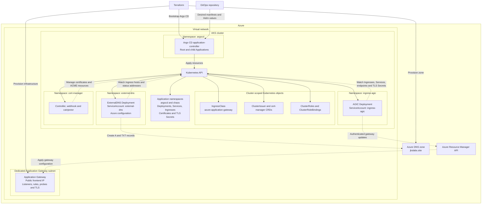
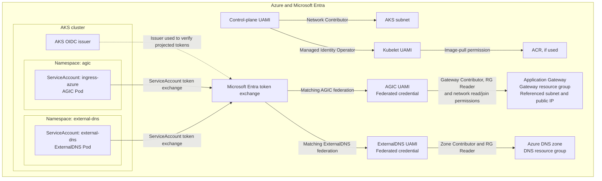
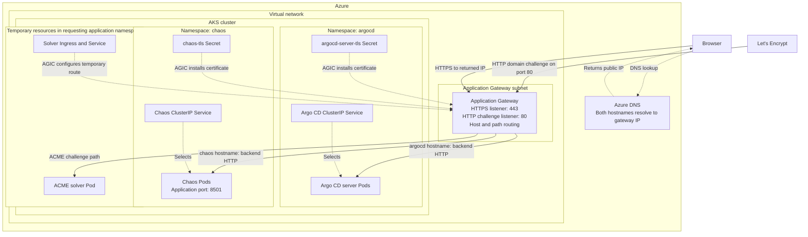

# AKS UK South AGIC sandbox

The cluster root selects `applications-project.yaml`, `platform-project.yaml`,
`platform/`, and `workloads/`. It renders three AppProjects and five Applications in
namespace `argocd`. Parent Kustomizations select local app folders. Each app's
Kustomization imports its catalog Application and applies local Application
patches. Cluster patches select provider values, child config paths, and Git
revisions; catalog manifests contain no cluster paths. The root does not render controller or workload resources.

Cert-manager, External DNS, and chaos-generator child Git sources deploy separate
`configs/` overlays. Each resource Kustomization and its patches live together;
Application patches stay beside the app-level Kustomization.
Helm children read their selected catalog and
inline cluster `helm.valuesObject` settings in `application-patches.yaml`. Argo CD uses the GitOps-owned `bootstrap` project; the Terraform root uses
`default`; runtime values and the handoff gate live in
[Argo CD configuration](platform/argocd/README.md).

Projects use wave `-4`; AGIC uses `-3`, External DNS `-2`, cert-manager `-1`,
chaos-generator `0`, and Argo CD `1`. Runtime Application health customization
makes the root wait for synced, healthy children. Minimal bootstrap lacks that
customization; verify initial children manually. Existing children reconcile
independently.

Selected Git sources use `dev/sandbox`. Publish reviewed configuration before
reconciliation. Verify Azure identities, gateway access, DNS, and certificates
separately from Application health.

See [bootstrap](../../../../../../../docs/bootstrap.md) for installation,
ownership transfer, and recovery.

**The diagrams separate configuration, identity and live traffic so each relationship stays readable.**

Solid arrows in the first diagram show deployment or resource relationships; dotted arrows show controller reconciliation.

The next diagram shows **authentication and Azure permission scopes**. Federated credentials connect particular ServiceAccounts to particular UAMIs; Kubernetes RBAC is a separate check.

Finally, this is the **browser traffic and certificate-validation path**. Services select the application backends; they are not shown as an additional ClusterIP packet hop.

Cert-manager requests and renews certificates; ExternalDNS maintains hostname records; AGIC configures Application Gateway. **Application Gateway is the component that actually receives your users’ HTTP/HTTPS requests.**
