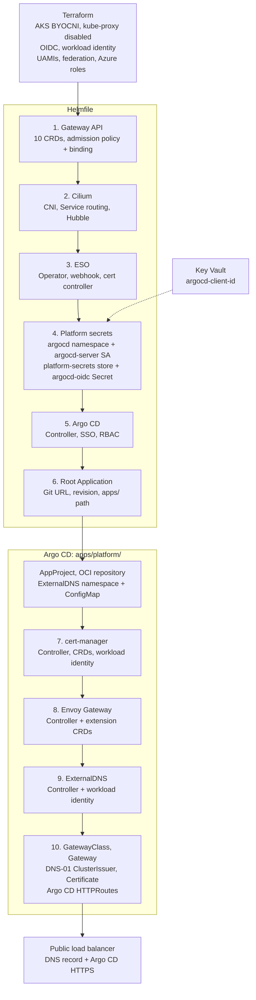

# AKS Envoy bootstrap

Terraform builds infrastructure. Helmfile installs bootstrap releases. Argo CD
then reconciles platform apps from Git.

## Installation flow



Numbers show installation order. Helmfile waits for the store and ExternalSecret
`Ready`, then checks `argocd-oidc` exists before starting Argo CD. SSO reads
`client-id` from that Secret; issuer stays in [argocd/values.yaml](argocd/values.yaml).

Root health checks gate child Applications between sync waves. Helmfile completion
does not mean DNS, certificates, or child Applications have finished reconciling.

## Prepare first

- Provision AKS with `network_plugin = "none"` and kube-proxy disabled. Enable
  OIDC and workload identity. Give the AKS identity required network permissions.
- Fill [platform secret values](external-secrets-config/values.yaml). Create Key
  Vault key `argocd-client-id` containing the Entra SSO application client ID.
- Configure Key Vault reader federation and secret-read access. Configure Entra
  federation, user assignments, and callback
  `https://argocd.jkslabs.site/auth/callback`. Both federations trust subject
  `system:serviceaccount:argocd:argocd-server`, the AKS OIDC issuer, and audience
  `api://AzureADTokenExchange`.
- Fill dedicated ExternalDNS and cert-manager UAMI client IDs and DNS permissions.
  See [platform prerequisites](../apps/platform/README.md#terraform-inputs).

Platform secrets creates `argocd-server`; Argo CD uses `serviceAccount.create: false`.
The ServiceAccount name and namespace must match each federation's subject.
Azure credential display names do not need to match.

## Deploy locally

Run from repository root. Install Helm 3, Helmfile, helm-diff, kubectl, Azure CLI,
kubelogin, and Python 3. CI pins Helm `3.18.6` and Helmfile `1.1.7`.

```sh
az login
az aks get-credentials --resource-group YOUR_AKS_RESOURCE_GROUP --name YOUR_AKS_CLUSTER_NAME
kubelogin convert-kubeconfig --login azurecli
kubectl config current-context
kubectl cluster-info --request-timeout=30s

export CILIUM_K8S_SERVICE_HOST="$(
  kubectl config view --minify -o jsonpath='{.clusters[0].cluster.server}' |
    python3 -c 'import sys; from urllib.parse import urlsplit; print(urlsplit(sys.stdin.read().strip()).hostname or "")'
)"
: "${CILIUM_K8S_SERVICE_HOST:?Missing API hostname in current kubeconfig}"

BOOTSTRAP=clusters/azure/DEV-JKS/dev/uks/sandbox/aks-envoy/bootstrap/helmfile.yaml
helmfile --file "$BOOTSTRAP" diff --suppress-secrets
# Review the diff, then approve the interactive apply prompt.
helmfile --interactive --file "$BOOTSTRAP" apply --suppress-secrets
```

Use the same kubeconfig context for discovery and deployment. Re-export the host
after switching clusters. Set hostname only, without `https://` or port; AKS uses
port `443`. [cilium/api.yaml.gotmpl](cilium/api.yaml.gotmpl) passes this variable
into Cilium's `k8sServiceHost`. Missing variable stops Helmfile rendering.

Laptop kubeconfig authenticates Helmfile. Cilium pods do not inherit it. With
kube-proxy disabled, Cilium needs the direct API endpoint before Service routing
works. A successful `kubectl cluster-info` check does not supply that chart value.

## GitHub Actions and AKS runners

The current [workflow](../../../../../../../../.github/workflows/helm-bootstrap.yaml)
uses `runs-on: ubuntu-24.04`. Its
[setup action](../../../../../../../../.github/actions/helm-bootstrap-setup/action.yaml)
loads the target kubeconfig, checks API access, discovers the hostname, and exports
`CILIUM_K8S_SERVICE_HOST` in both plan and apply jobs. No manual export is needed.

An AKS-hosted self-hosted runner still needs this value. Runner location does not
configure Cilium's API connection. Keep discovery against the target cluster's
kubeconfig, even when the runner runs inside another AKS cluster.

Use an existing working runner for first bootstrap. An ordinary pod runner in
the fresh target cluster needs working CNI before it can start.

## Ownership and files

- [helmfile.yaml](helmfile.yaml): chart pins, release dependencies, readiness checks.
- [cilium/values.yaml](cilium/values.yaml): CNI and Hubble; Cilium Gateway controller disabled.
- [Shared ESO values](../../../../../../../../catalog/platform/external-secrets/values.yaml): generic operator settings.
- [external-secrets-config/values.yaml](external-secrets-config/values.yaml): namespace, shared ServiceAccount, Key Vault store, ExternalSecret.
- [argocd/values.yaml](argocd/values.yaml): installation, SSO, RBAC, internal HTTP Service.
- [argocd-config/values.yaml](argocd-config/values.yaml): root source, selecting [apps/](../apps/kustomization.yaml).

Helmfile owns these releases. Argo CD owns platform children and routing. Gateway
API uses official Envoy chart `v1.9.2`, standard Gateway API bundle `v1.6.1`;
Envoy's child installs only extension CRDs. Shared CRDs have no uninstall retention
annotation. Cilium preflight stays disabled during initial installation.

Existing Helm or Terraform owners require an ownership handoff. Do not delete
CRDs or ServiceAccounts to transfer ownership. See the
[full guide](../../../../../../../../docs/helm-bootstrap.md) for migration, upgrades,
GitHub approval setup, and deployed-cluster checks.
